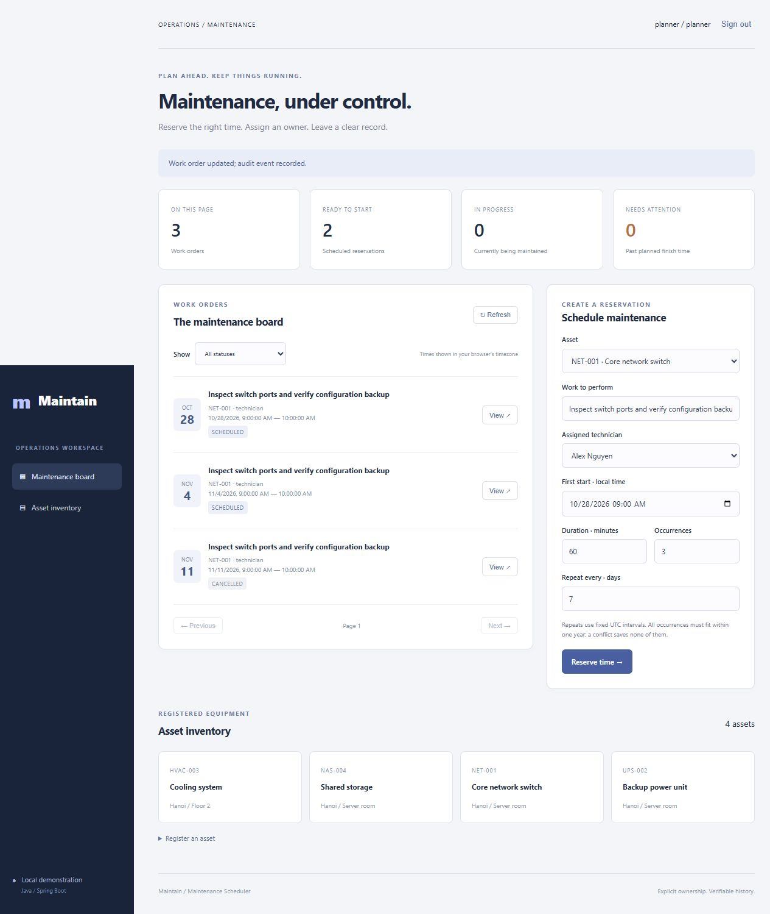

# Maintain — Maintenance Scheduler

[](https://github.com/ThanhVu90/maintenance-scheduler/actions/workflows/ci.yml)

A Java 21 / Spring Boot workspace for maintenance reservations, assigned technicians and auditable work history. It rejects concurrent double booking, creates recurring batches atomically and rejects stale workflow updates.



## Run locally

Requires JDK 21 and Maven 3.6.3+. Verified with Microsoft OpenJDK 21.0.13.0.2 and Maven 3.10.0.

```sh
mvn verify
java -jar target/maintenance-scheduler-1.0.0.jar
```

Open http://127.0.0.1:5082/. Stop the server before rebuilding its JAR on Windows.

| Demo username | Demo password | Permissions |
| --- | --- | --- |
| planner | planner-demo-only | Register assets, book recurring work, cancel scheduled work |
| technician | technician-demo-only | Start and complete assigned work |
| viewer | viewer-demo-only | Read inventory, reservations and history |

These are intentionally public local demonstration credentials. Override PLANNER_PASSWORD, TECHNICIAN_PASSWORD and VIEWER_PASSWORD through environment variables. Use synthetic data only. The app binds to loopback and is not configured for public hosting.

Flyway initializes four synthetic assets and one technician. Work orders start empty. The local H2 database in var/ persists across restarts and is excluded from Git.

## Review the workflow

1. Sign in as planner and book up to 12 recurring occurrences for an asset and technician.
2. Try an overlapping window on another asset assigned to the same technician: it is rejected.
3. Inspect an order's history, or cancel scheduled work with a reason to release its reservation.
4. Sign in as technician. Once scheduled start time arrives, start and complete assigned work with notes.
5. Sign in as viewer to inspect read-only access. Server authorization enforces the same boundaries as the UI.

## Engineering decisions

| Concern | Implementation |
| --- | --- |
| Concurrent double booking | Database mutex row locked before checking resource windows |
| Recurrence | One transaction for batch, occurrences and audit records; any conflict rolls back all |
| Safe retry | UUID idempotency key, payload hash, actor match and persisted batch membership |
| Stale edits | Expected version checked under lock; HTTP 409 on mismatch |
| Accountability | Assigned-technician ownership, mandatory notes, transactional audit |
| Time | UTC instants in storage; browser-local display; fixed UTC day recurrence |
| Authentication | Spring Security sessions, BCrypt, CSRF including login/logout, role checks |
| Schema | Flyway migrations, foreign keys and uniqueness constraints |
| Verification | 42 tests with real transactions and security filters; Windows/Ubuntu CI |

Run `mvn verify` for tests, JAR packaging and Spotless formatting checks. See [architecture](docs/ARCHITECTURE.md), [API](docs/API.md) and [verification](docs/VERIFICATION.md).

## Scope and limits

This is a single-process localhost portfolio application. The global database lock trades write throughput for simple correctness. No PostgreSQL or multi-instance compatibility is claimed. Direct database writes bypass application invariants.

Recurring occurrences are materialized on submission, not generated by a background job. There are no email reminders or device commands. Recurrence uses elapsed UTC days, not civil-time rules that preserve local time through DST. All occurrences must start within 366 days.

Conflicts apply to planned windows; overrunning work does not automatically extend its reservation. Statistics reflect the displayed page/filter (100 rows maximum), and audit history returns the newest 100 events per order.

Public hosting would require identity lifecycle management, HTTPS, secure cookies, login throttling, monitoring, backup/recovery and a reviewed database design. The demo credentials and in-memory user directory are deliberately not a production configuration.

Developed with AI assistance. No employment history, production deployment or customer usage is claimed.
