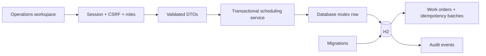
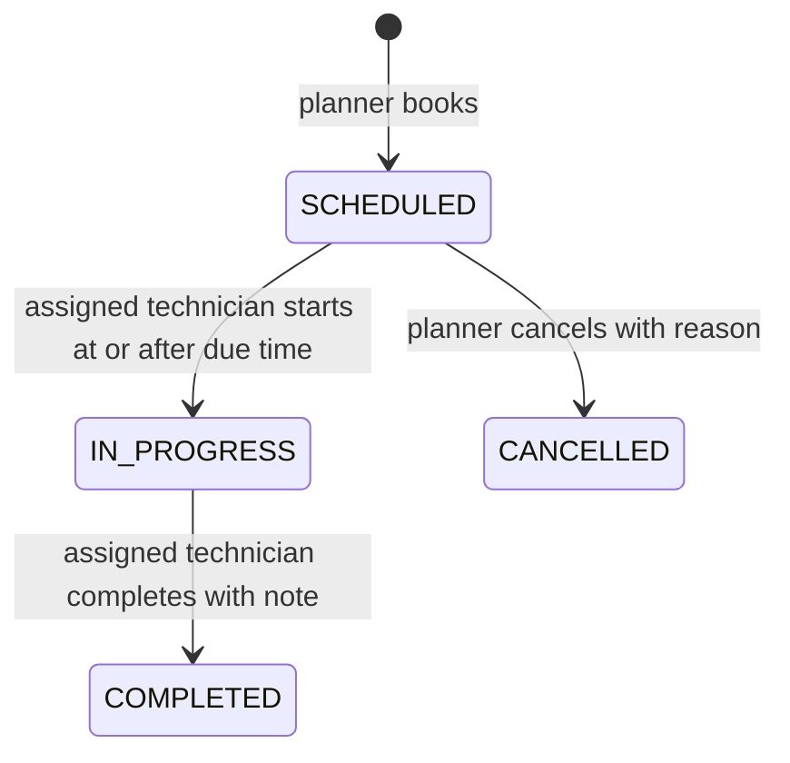

# Architecture and tradeoffs

## Transaction ordering

Scheduling mutations acquire row 1 in schedule_lock with SELECT FOR UPDATE. The lock remains held until commit/rollback. The service then reads current state, validates versions or retry keys, checks collisions and writes changes with audit entries. This prevents two requests from both observing an empty window and inserting conflicting reservations. Concurrency tests use two threads, independent connections and real Spring-managed transactions.

A single mutex reduces throughput even for unrelated assets. That is an explicit local-demo tradeoff. A larger deployment would need ordered resource locks or database range constraints, tested on the target database. Java synchronized alone would protect only one object in one JVM.

Overlap uses existing.start < requested.end AND existing.end > requested.start, allowing adjacent windows. It applies to the same asset OR the same technician, while status is SCHEDULED or IN_PROGRESS. Completed/cancelled orders no longer block reservations.

## Retry semantics

Each booking has a canonical lowercase UUID Idempotency-Key. The persisted batch stores the request payload SHA-256 and actor. Under the same database lock, identical retries return the existing orders, even after their scheduled start has passed. A changed payload or actor returns 409. The browser retains its key after a failed request until the payload changes or success is received.

Retries return current order state, not an immutable copy of the first response. Keys are retained indefinitely in this demonstration. Production retention must preserve an explicitly defined retry window.

## State machine

Each transition compares an expected version under lock. State update and audit event commit together. Completing before start, cancelling in-progress work and changing someone else's assignment are rejected. Overdue is derived from planned end, unfinished status and an injected Clock, rather than a separately persisted status.

## Time and persistence

UTC Instant values are mapped to JDBC OffsetDateTime and SQL TIMESTAMP WITH TIME ZONE. Browser-local input becomes ISO UTC before submission. Recurrence adds fixed 24-hour days, so daylight-saving civil-time preservation is out of scope. Clock injection makes tests deterministic.

Flyway owns schema and synthetic inventory initialization. H2 file persistence is used locally; tests use an isolated in-memory database. Foreign keys, allowed-status/window checks and unique batch-occurrence keys reinforce integrity. H2 Console is not exposed.

## Security boundaries

Spring Security manages sessions, role enforcement and CSRF on login/logout and mutations. BCrypt includes Spring's encoder identifier. Service ownership checks complement controller roles. DTOs bound titles, notes, duration and recurrence count; unknown JSON fields fail validation. Frontend uses textContent for user content and a same-origin CSP.

Default credentials, no login lockout and an embedded database make this inappropriate for public deployment. Audit history is application accountability, not a tamper-proof compliance ledger. No external remediation or notification tool is connected.
